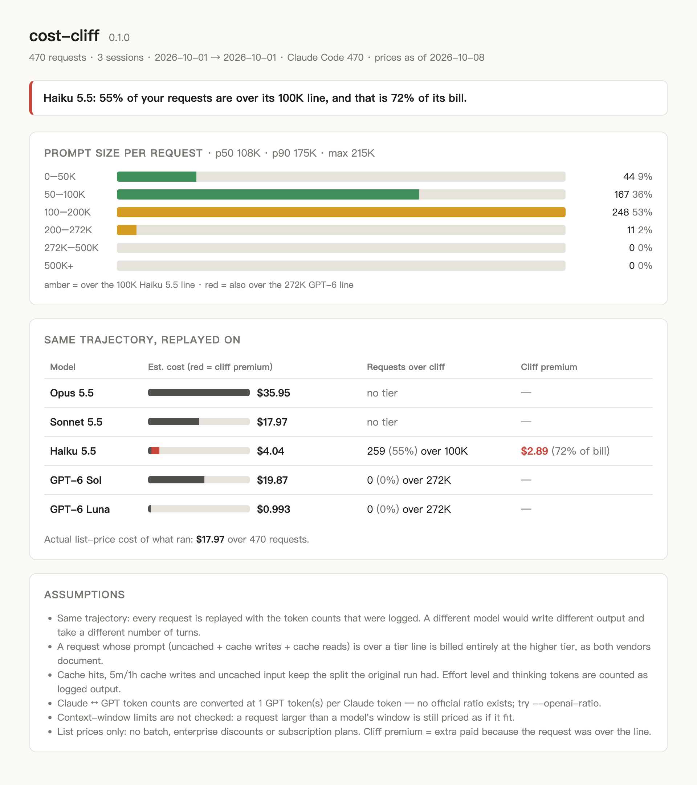

# cost-cliff

**Would the cheap model really have been cheaper?** cost-cliff replays your own Claude Code and Codex sessions against other models' price tables. It includes the prompt-length tiers that list prices hide: the Haiku 5.5 line at 100K tokens and the GPT-6 line at 272K.

<!-- agent-preflight -->
> **Also a Claude Code skill.** `cost-cliff` is part of [agent-preflight](https://github.com/thinx-pro/agent-preflight), 16 offline checks for coding agents: `/plugin marketplace add thinx-pro/agent-preflight` then `/plugin install cost-cliff@agent-preflight`, and ask Claude in plain words.

   



<sub>The screenshot shows the bundled **synthetic** demo: three agent sessions whose context grows a few K tokens per turn and gets compacted. Run cost-cliff on your own logs to get your own numbers.</sub>

## Why

Claude Haiku 5.5 costs $0.10 / $0.50 per million tokens, but only for prompts up to 100,000 tokens. A longer prompt is billed **entirely** at $0.50 / $2.50, five times as much ([Anthropic pricing](https://platform.claude.com/docs/en/about-claude/pricing)). GPT-6 Luna and Sol do the same thing above 272K ([OpenAI pricing](https://developers.openai.com/api/docs/pricing)). Agent sessions resend their whole context every turn, so a long session spends most of its turns over 100K.

When Haiku 5.5 launched, a widely discussed r/ClaudeAI comparison found the same task cost 12.7× more on Haiku 5.5 than on GPT-6 Luna, The prompt wasn't published, but commenters agreed the 100K tier was the main reason. You can't tell from a price page which model is cheaper **for your work**. Your logs can tell you, because they record every request's prompt size and cache split.

## Quick start

```bash
npx github:thinx-pro/cost-cliff
```

This reads `~/.claude/projects` and `~/.codex/sessions` for the last 30 days and prints a report. Nothing leaves your machine.

```bash
npx github:thinx-pro/cost-cliff --since all --html report.html   # all history + HTML report
```

## What you get

```text
cost-cliff 0.1.0  470 requests · 3 sessions · 2026-10-01 → 2026-10-01
sources: Claude Code 470 · prices as of 2026-10-08

Prompt size per request   p50 108K · p90 175K · max 215K
  0–50K      █████                               44    9%
  50–100K    ████████████████████               167   36%
  100–200K   ██████████████████████████████     248   53%
  200–272K   █                                   11    2%
  272K–500K                                       0    0%
  500K+                                           0    0%

Same trajectory, replayed on
  model          est. cost   requests over cliff   cliff premium
  Opus 5.5          $35.95   no tier               —
  Sonnet 5.5        $17.97   no tier               —
  Haiku 5.5          $4.04   259 (55%) >100K       $2.89 (72% of bill)
  GPT-6 Sol         $19.87   0 >272K               —
  GPT-6 Luna        $0.993   0 >272K               —

Actual list-price cost of what ran: $17.97 over 470 requests
→ Haiku 5.5: 55% of your requests are over its 100K line, and that is 72% of its bill.
```

(This output is from the synthetic demo in `demo/`. To reproduce it, clone the repo and run `node bin/cost-cliff.js demo --since all`. `scripts/make-demo.js` regenerates the demo sessions.)

- **Prompt-size histogram** of every request, colored by which tier lines it crosses.
- **Replay table**: the same requests priced on each model, how many cross that model's tier line, and the **cliff premium**, meaning the extra you'd pay because those requests went over the line.
- **Actual cost** of what ran, at list price for the model that actually served each request. This includes Opus fast mode and the 1.1× US-only inference multiplier when the log records them.
- `--json` for scripts and `--html` for a self-contained report you can share.

## Options

```text
--since <30d|12h|YYYY-MM-DD|all>  time window (default: 30d)
--source <claude|codex|all>       which default log dirs to read
--project <text>                  only sessions whose project name contains text
--models <id,id,...>              models to replay on (see --list-models)
--openai-ratio <n>                GPT tokens per Claude token (default: 1, an assumption)
--no-sidechain                    ignore subagent (sidechain) requests
--prices <file>                   your own price table (same shape as prices.json)
--json / --html <file>            machine-readable output / HTML report
```

You can also pass `.jsonl` files or directories as arguments, and cost-cliff detects the format of each file.

## How it works

1. **Parse.** For Claude Code, cost-cliff reads `assistant` lines and their `usage`. It dedupes on message id, because Claude Code writes one line per content block, and it treats each server-side `iteration` as its own model call. For Codex, it reads `token_count` events (`last_token_usage`), dedupes repeated snapshots, and takes the model from `turn_context`.
2. **Size each request.** Prompt size = uncached input + cache writes (5m and 1h) + cache reads. This is the number vendors use to pick a tier.
3. **Price it.** For each target model, cost-cliff picks the tier from the prompt size and bills the **whole** request at that tier. It keeps the original cache split and uses each model's own cache-hit multiplier (0.05× on Opus/Sonnet 5.5, 0.1× elsewhere).
4. **Convert tokenizers when needed.** Claude 4.7 and later produce about 30% more tokens than earlier Claude models (Anthropic's figure), and cost-cliff applies that. Vendors publish no Claude↔GPT ratio, so the default is 1.0 and you can override it with `--openai-ratio`.

All prices are in [`prices.json`](prices.json), with source links and a retrieval date. To use your own (for example, negotiated rates), pass `--prices my.json`.

## Limitations

- **Same trajectory.** A different model would write different output, take a different number of turns and compact at different times. The replay tells you what *these* requests would cost, not what a whole session on that model would cost.
- Context-window limits are not checked.
- Effort level isn't modeled separately. Thinking tokens are already counted in the logged output.
- List prices only: no batch, Flex, Priority, enterprise discounts or subscription plans. For subscription users, the "actual" number is what the same usage would cost on the API, not what you paid.
- OpenAI lists no cache-write price for `gpt-5.5`, so those writes are billed at the input rate. GPT-5.6 Sol pricing is promotional.
- The log formats are undocumented and could change. Please open an issue with a redacted line if parsing breaks.

## Roadmap

- `--what-if-compact <N>`: estimate savings from compacting before a tier line.
- Per-session and per-project breakdowns, plus "which sessions would suit Haiku" hints.
- A price-table update command and more vendors (Gemini, DeepSeek).
- Read AUDR records.

## License

MIT. Prices belong to their vendors and are reproduced for comparison. Check the linked pages before you make budget decisions.

---

### 中文说明

**cost-cliff**：用你自己的 Claude Code / Codex 会话日志回放估价，回答「换成便宜模型到底省不省」。核心是「分档断崖」：Haiku 5.5 的 prompt 一旦超过 10 万 token，整次请求按 5 倍价计费；GPT-6 的分档线是 27.2 万。Agent 会话每轮都会重发整段上下文，大部分请求都落在断崖之上。`npx github:thinx-pro/cost-cliff` 一行运行，零依赖，只读本地文件，不联网。价格来自两家官方定价页（2026-10-08），跨厂商的分词器换算没有官方系数，默认按 1:1 估算，可用 `--openai-ratio` 调整。
